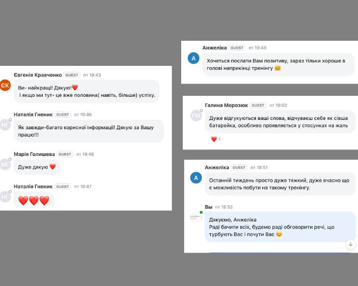

Тут є три важливі складові:
- збереження стосунків / сім'ї як головна цінність;
- зменшення агресії та емоційної напруги;
- конкретна перспектива — навчитися чути одне одного й відновлювати контакт.

